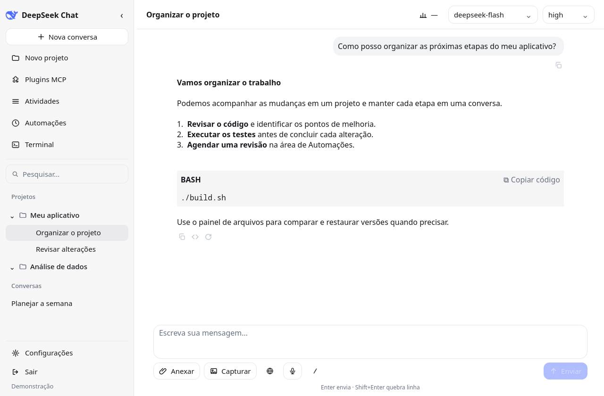
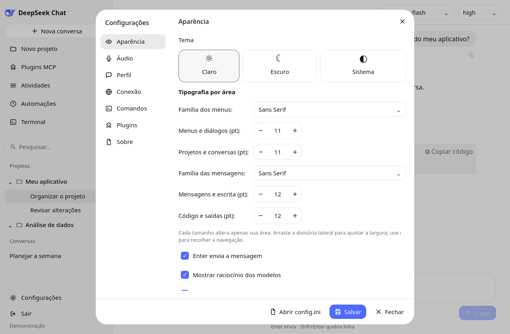
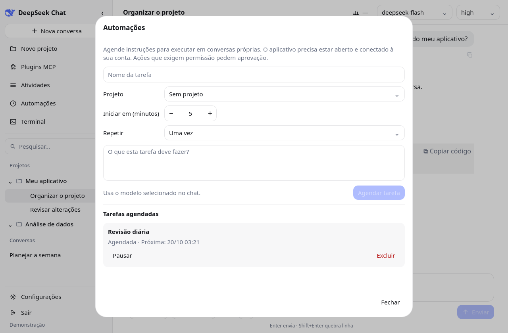
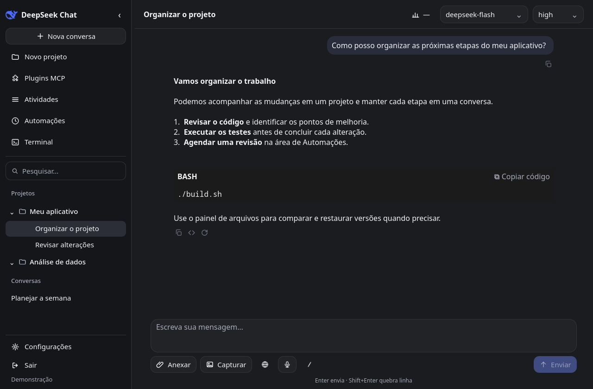
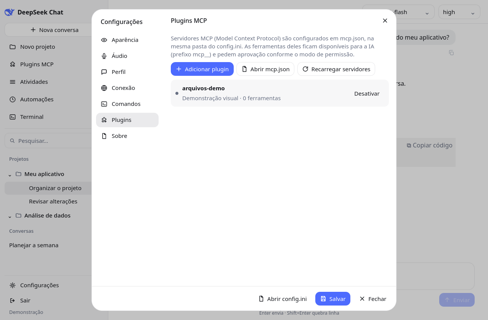

# DeepSeek Chat — Desktop

Cliente desktop **Qt 6 / QML** com **backend PHP** para conversar com modelos DeepSeek
usando um **agente com acesso ao computador**: lê e grava arquivos, executa comandos,
baixa páginas/arquivos, navega com navegador headless e integra servidores MCP —
tudo com **modos de permissão** e confirmação do usuário.

Autor: **Carlos Alberto Perego** — [carlos.pw](https://carlos.pw)

---

## Interface

A versão 1.2.0 unifica os controles e reorganiza a navegação e as configurações,
tomando o [DeepSeek Harness](https://github.com/deepseek-ai/deepseek-harness) como
referência visual. O cliente continua sendo um aplicativo Qt independente; os
plugins disponíveis são servidores MCP stdio, e não bundles Cordis do Harness.

As imagens abaixo são capturas do aplicativo com dados fictícios, sem conta real.



| Configurações | Automações |
|---|---|
|  |  |

| Tema escuro | Plugins MCP |
|---|---|
|  |  |

Para reproduzir as capturas e consultar os cenários verificados, veja
[`docs/REVISAO-1.2.0.md`](docs/REVISAO-1.2.0.md).

## Recursos

**Chat**
- Streaming SSE ao vivo, raciocínio dos modelos, Markdown formatado (tabelas, listas,
  código com realce, links clicáveis e imagens inline).
- Anexos de texto, imagens (miniatura no composer), PDF/DOCX/ODT (extração de texto),
  colar (Ctrl+V) e arrastar-e-soltar.
- Copiar, copiar código, **editar mensagem**, **regenerar** e **ramificar** uma conversa
  a partir de qualquer mensagem, preservando a versão original.
- Captura de uma área da tela ou da janela do aplicativo para anexar à mensagem.
- **Várias conversas processando em paralelo**, cada uma com indicador próprio.
- Fila de mensagens, títulos automáticos e compactação de contexto.

**Organização**
- Projetos com pasta de trabalho, instruções (system prompt), arquivos e comandos `/`.
- Memórias editáveis por projeto, reutilizadas nas próximas conversas daquele projeto.
- Pasta do projeto lida direto do disco, com "Alterar pasta" na hora.
- Busca no título e **no conteúdo** das conversas.
- Exportar conversa em Markdown; painel de custos + **saldo DeepSeek**; atividades.
- Painel de arquivos com edição, prévia de Markdown/HTML/SVG, comparação de alterações
  e restauração de versões anteriores.

A prévia HTML usa o texto rico do Qt e não executa JavaScript nem CSS avançado.

**Agente (ferramentas)**
- Arquivos: `list_files`, `read_file`, `write_file`, `find_files`, `grep_files`,
  `restore_file` (backup automático das gravações).
- Sistema/Internet: `run_command`, `download_file`, `search_web`, `fetch_url`,
  `browse_url` (Edge/Chrome headless com fallback). Páginas consultadas aparecem
  com link e trecho junto à resposta.
- **MCP** (Model Context Protocol, stdio): tools, resources e prompts de servidores
  configurados em `mcp.json`. É possível adicionar e ativar/desativar servidores em
  **Configurações → Plugins MCP**, com estado da conexão e contagem de ferramentas.
- Respostas MCP isoladas por servidor, timeout de chamadas e recuperação quando
  um servidor encerra. Recarregar plugins durante chamadas pendentes é bloqueado.
- **Permissões por projeto**: *Solicitar aprovação*, *Aprovar por mim* e
  *Acesso completo*, com "não perguntar nesta conversa" e "sempre permitir neste projeto".
- Comandos destrutivos conhecidos (`rm -rf /`, `format`, `del /s`, fork bombs…)
  pedem confirmação **mesmo** em Acesso completo.

**Aplicativo**
- Login multiusuário; token protegido por DPAPI no Windows. No Linux/macOS,
  o armazenamento usa base64 e permissões restritas no `config.ini`; base64 não é criptografia.
- Bandeja do sistema: fechar minimiza e continua em segundo plano; notificações de
  resposta pronta; menu Abrir/Sair.
- **Atualização automática** (Windows): baixa, extrai, substitui e reabre o app.
- Tema claro/escuro/sistema, TTS e ditado por voz (Whisper externo).
- **Automações locais**: tarefas únicas, horárias, diárias ou semanais, cada uma
  em uma conversa própria. Permite pausar, parar, excluir e abrir resultados.
  Requer aplicativo aberto e conta conectada. Agendamentos são separados por
  backend e usuário; ações que exigem permissão pedem aprovação.
- Streaming com atualizações visuais agrupadas a cada 33 ms; saída de comandos
  drenada continuamente com retenção limitada do início e do final.

---

## Arquitetura

```
┌────────────────────────────┐        HTTPS/JSON + SSE        ┌──────────────────────────┐
│  deepseek-chat (Qt 6/QML)  │ ─────────────────────────────▶ │  deepseek-api (PHP)      │
│  Windows / Linux / macOS   │ ◀───────────────────────────── │  SEU_DOMINIO/deepseek     │
└────────────────────────────┘                                └────────────┬─────────────┘
        │ agent loop (tools locais)                                         │
        ▼                                                                  ▼
  arquivos, comandos, MCP, navegador                      MariaDB (histórico) + API DeepSeek
```

- O app **nunca vê** a API key nem credenciais do banco: só um token Bearer.
- O backend guarda a chave, fala com a API DeepSeek e registra conversas, tokens/custos,
  projetos e atividades.
- Detalhes em [`docs/ARQUITETURA.md`](docs/ARQUITETURA.md).

## Estrutura do repositório

```
deepseek-chat/            aplicativo desktop (Qt 6/QML, qmake)
  src/                    núcleo C++ (config, HTTP, streaming, agente, áudio)
  qml/                    telas QML
  sql/setup.sql           schema do MariaDB
  build.sh / build-windows.bat
  INSTALACAO.md           instalação detalhada (Linux/Windows/macOS)
deepseek-api/             backend PHP
  index.php, src/         rotas, auth, proxy DeepSeek
  sql/api_tokens.sql
  DEPLOY-ISPConfig.md     deploy no servidor
docs/                     documentação (arquitetura, API, ferramentas)
```

## Requisitos

- **Qt 6.11+** (Core, Gui, Widgets, Quick, Qml, Network, Multimedia, TextToSpeech, Svg, Pdf)
- Compilador C++17 (MinGW 64 ou MSVC; gcc/clang no Linux/macOS)
- Servidor com **PHP 8+**, MariaDB/MySQL e um site HTTPS para o backend

## Compilar e executar

Windows (Qt no PATH):

```bat
cd deepseek-chat
build-windows.bat
windeployqt bin\deepseek-chat.exe
bin\deepseek-chat.exe
```

Linux/macOS:

```bash
cd deepseek-chat
./build.sh
./bin/deepseek-chat
```

Passo a passo completo (dependências por sistema, áudio, troubleshooting):
[`deepseek-chat/INSTALACAO.md`](deepseek-chat/INSTALACAO.md).

## Backend

1. Suba `deepseek-api/` no servidor (ver
   [`deepseek-api/DEPLOY-ISPConfig.md`](deepseek-api/DEPLOY-ISPConfig.md)).
2. Crie `config.php` (baseado em `config.example.php`) com banco, chave DeepSeek e,
   opcionalmente, outros provedores OpenAI-compatíveis.
3. Aplique o schema de `deepseek-chat/sql/setup.sql` + `deepseek-api/sql/api_tokens.sql`.
   Em uma instalação existente, aplique apenas
   `deepseek-api/sql/2026-09-28-chat-features.sql` antes de usar ramificações,
   memórias e fontes das respostas.
4. Teste: `curl https://SEU_DOMINIO/deepseek/health`.

## Configuração do app

`config.ini` fica ao lado do executável (modelo em `config.ini.example`):

```ini
[api]
base_url=https://SEU_DOMINIO/deepseek
token=            ; gravado após o login (DPAPI no Windows; base64 no Linux/macOS)

[ui]
permission_mode=ask    ; ask | auto | full (padrão para projetos novos)
notify_on_finish=true
close_to_tray=true
```

Tudo também é editável em **Configurações** dentro do app.

## Atualizações

O app verifica `GET /version.txt` no backend e, se houver versão nova, baixa
`/download/deepseek-chat-windows-x64.zip`, extrai, substitui os arquivos com o app
fechado e o reabre automaticamente (Windows). `config.ini` e `mcp.json` são preservados.

## Documentação

- [`docs/ARQUITETURA.md`](docs/ARQUITETURA.md) — componentes e fluxos
- [`docs/API.md`](docs/API.md) — endpoints do backend
- [`docs/FERRAMENTAS.md`](docs/FERRAMENTAS.md) — ferramentas do agente e permissões
- [`deepseek-chat/INSTALACAO.md`](deepseek-chat/INSTALACAO.md) — instalação e uso
- [`deepseek-api/DEPLOY-ISPConfig.md`](deepseek-api/DEPLOY-ISPConfig.md) — deploy

## Licença

Veja [`LICENSE`](LICENSE).
